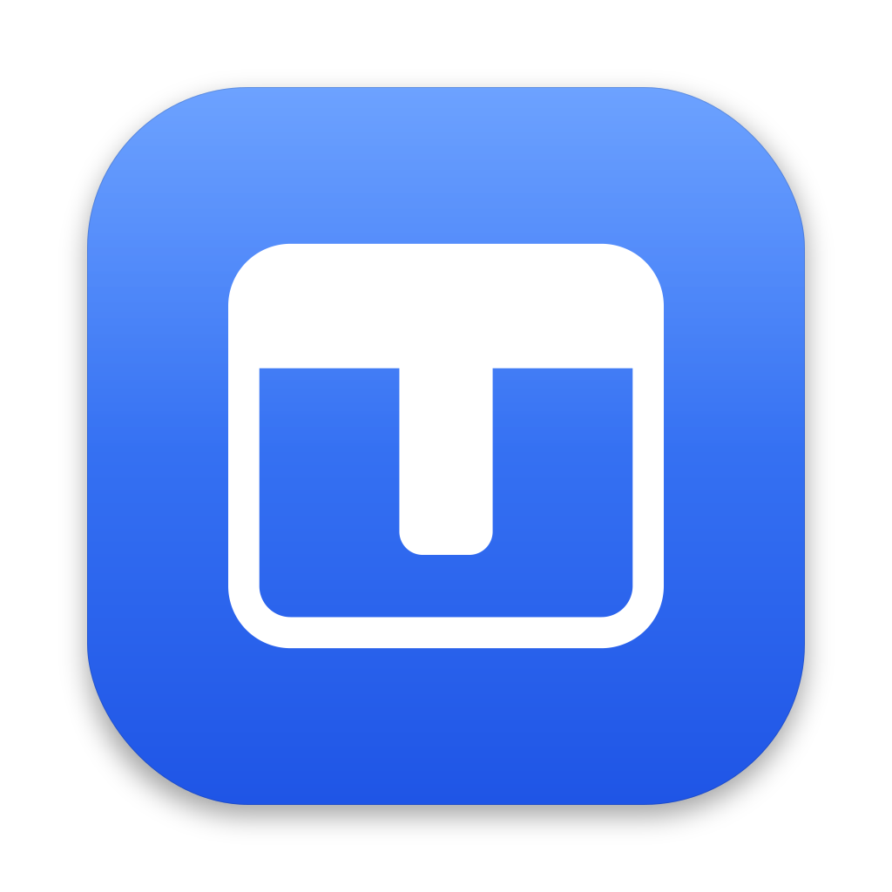

<p align="center">
  
</p>

# Tabsome

A macOS menu bar app that turns any windows, from any apps, into browser-style tabs of one window.
The build plan and every design decision are in [PLAN.md](PLAN.md).

## Build, run, test

Requires macOS 26+, Xcode 26+, and an Apple Development certificate in the login keychain
(see PLAN.md §3, "Prerequisites").

```bash
xcodebuild -project Tabsome.xcodeproj -scheme Tabsome -configuration Debug -derivedDataPath build build
```

```bash
open build/Build/Products/Debug/Tabsome.app
```

```bash
xcodebuild -project Tabsome.xcodeproj -scheme Tabsome -configuration Debug -derivedDataPath build test
```

Or open `Tabsome.xcodeproj` in Xcode and press ⌘R / ⌘U.

The first launch walks through granting Accessibility (System Settings › Privacy & Security ›
Accessibility). Builds are signed with the same Apple Development identity, so the permission
survives rebuilds.

**Debug builds** add "Dump Window Registry (Debug)" to the menu. For a scripted check:

```bash
open build/Build/Products/Debug/Tabsome.app --args -TabsomeDebugDumpAfter 3 -TabsomeDebugQuitAfterDump YES
```

The dump is written to `~/Library/Application Support/Tabsome/Debug/registry-dump.txt`. It is the
only place window titles appear; logs (`~/Library/Logs/Tabsome`) never contain them.

## Layout

| Path | What's there |
|---|---|
| `Tabsome/App` | App entry, menu bar, onboarding, Settings, appearance, debug dump |
| `Tabsome/Core/AX` | The only code that talks to Accessibility (`AXWindow`, `AXApp`), the window registry, permissions |
| `Tabsome/Core/Support` | Logging and the app's own folders |
| `Tabsome/UI` | Motion tokens, metrics, system accessibility settings |
| `TabsomeTests` | Unit tests (Swift Testing) |
| `scripts/check-ax-usage.sh` | Build-phase check that AX APIs stay in `AXWindow`/`AXApp` (PLAN.md §6.1 S1) |
| `Spikes/` | Phase 0 throwaway spikes and their findings |
| `Design/Icon` | Icon sources |
